# Baude

Baude is a GTK4 / libadwaita desktop app for [Claude Code](https://claude.com/claude-code). It runs the `claude` CLI
and shows the chat, its tool calls and every session on the machine.

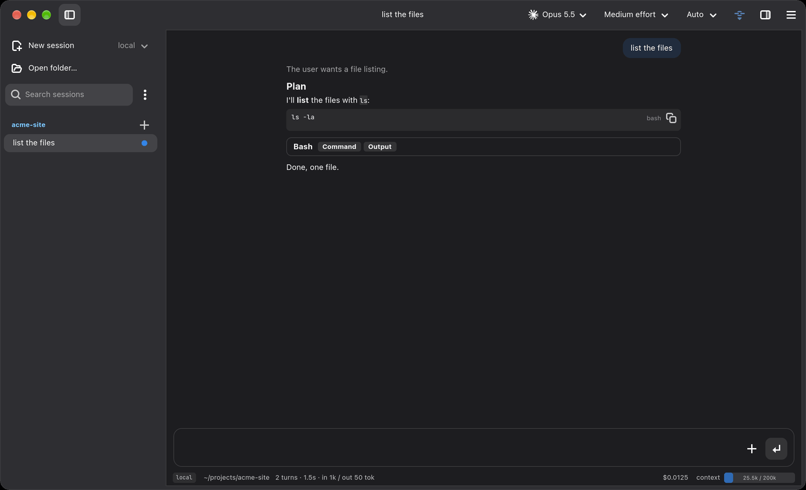

## Chat

| | |
|---|---|
| 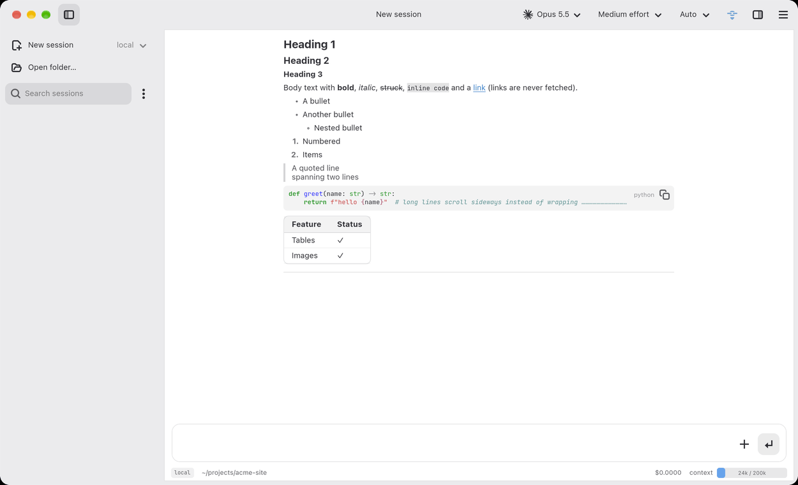<br>Markdown | 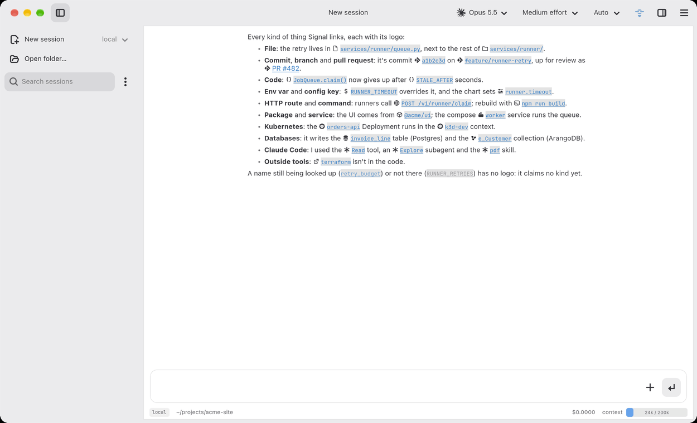<br>Signal links |
| 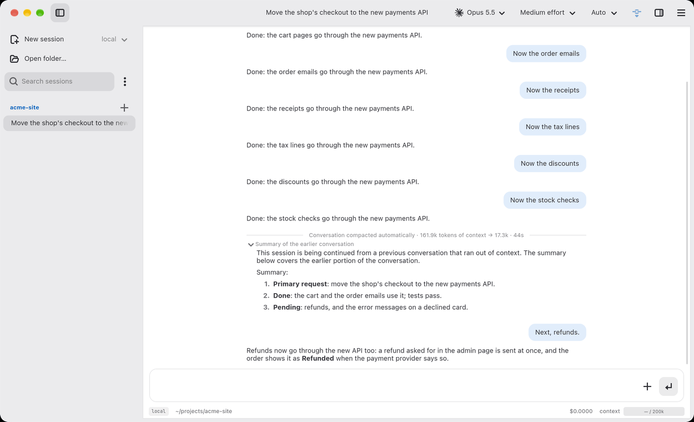<br>Where Claude compacted the chat | 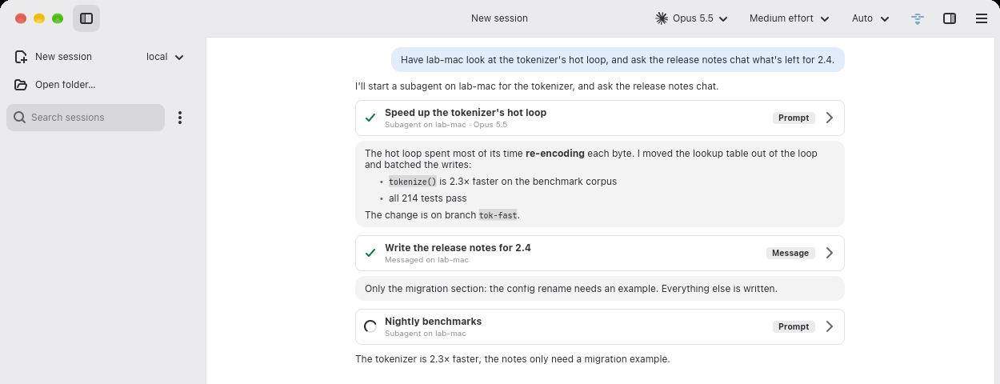<br>Subagents and messages across the mesh |

Code is set in JetBrains Mono, at the size that matches the text around it. Settings → Code Font picks another:
the open fonts in [fonts/](fonts/README.md) (SIL Open Font License), or macOS's SF Mono and Menlo.

## Tools and permissions

| | |
|---|---|
| 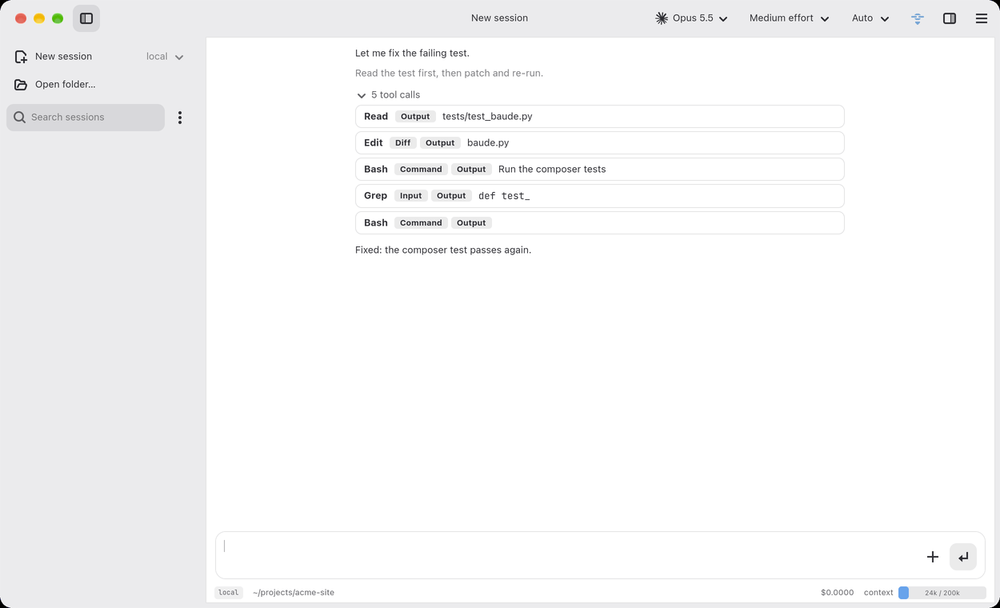<br>Tool calls | 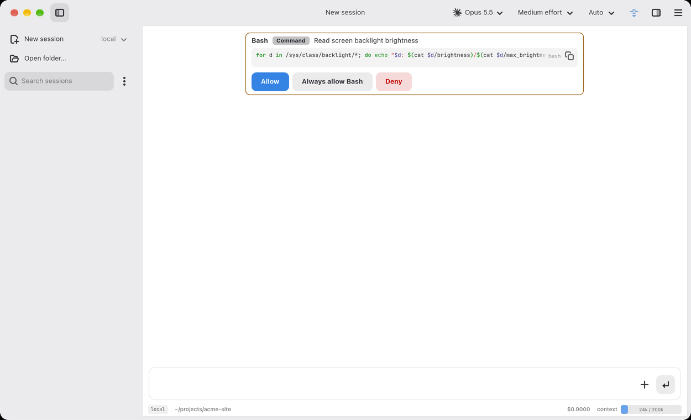<br>Command approval |
| 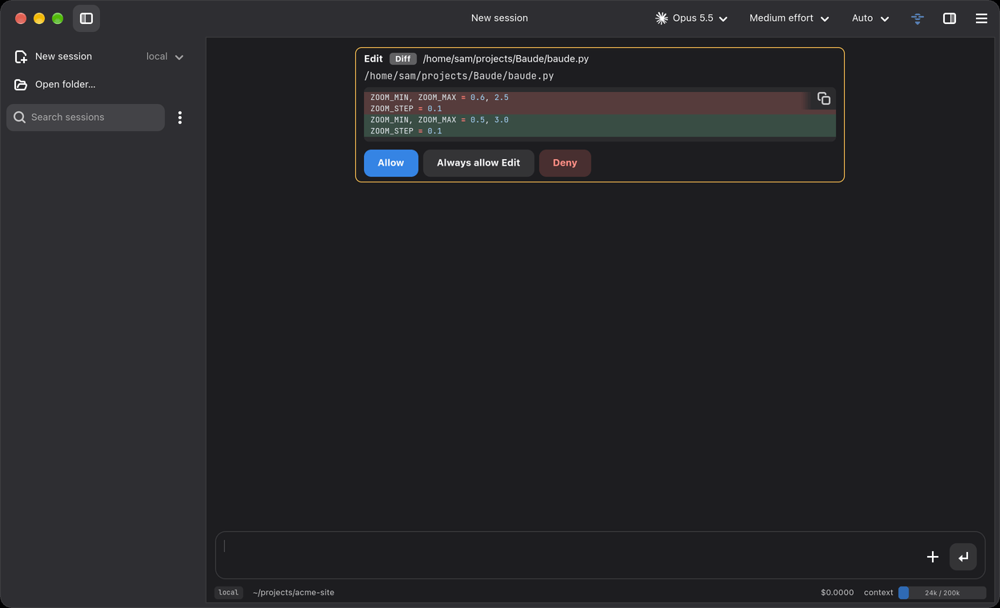<br>Edit approval | 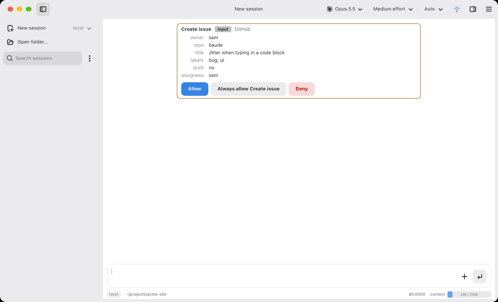<br>MCP tool approval |

## Git and Kubernetes

| | |
|---|---|
| 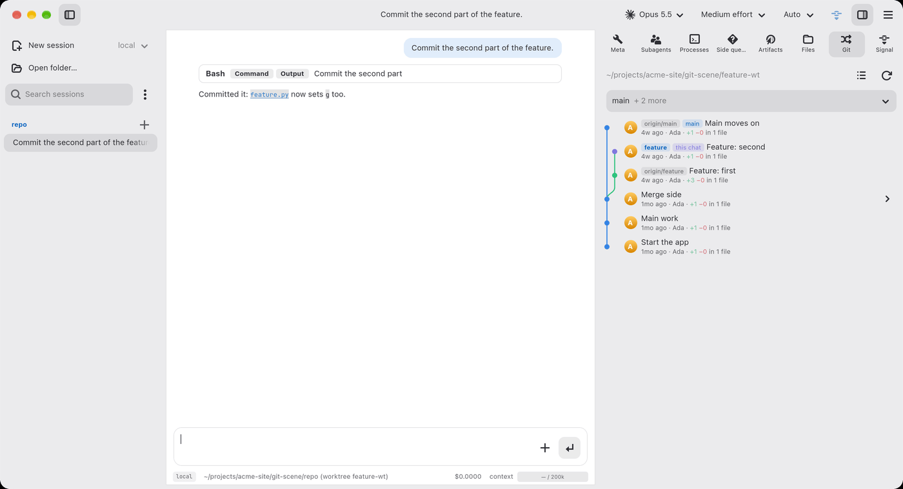<br>Git history | 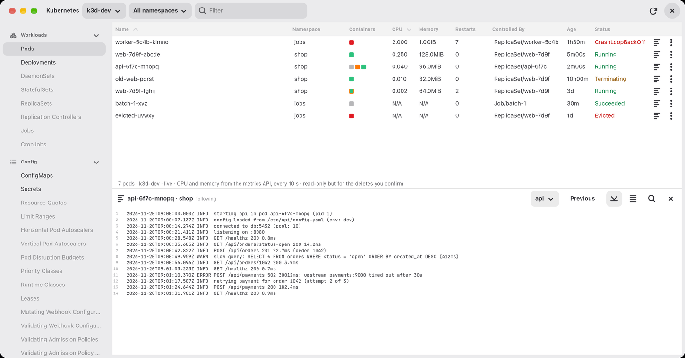<br>Kubernetes pods and logs |

## Input and feedback

| | |
|---|---|
| 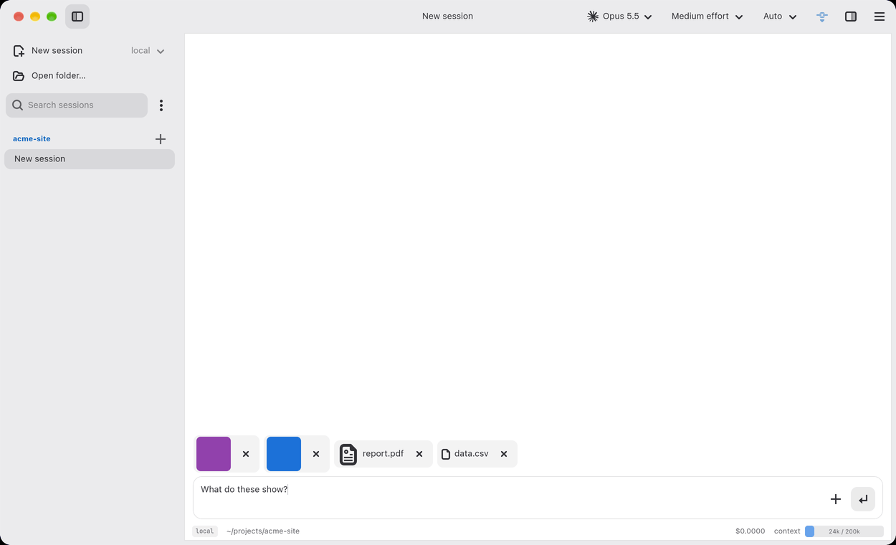<br>Attachments | 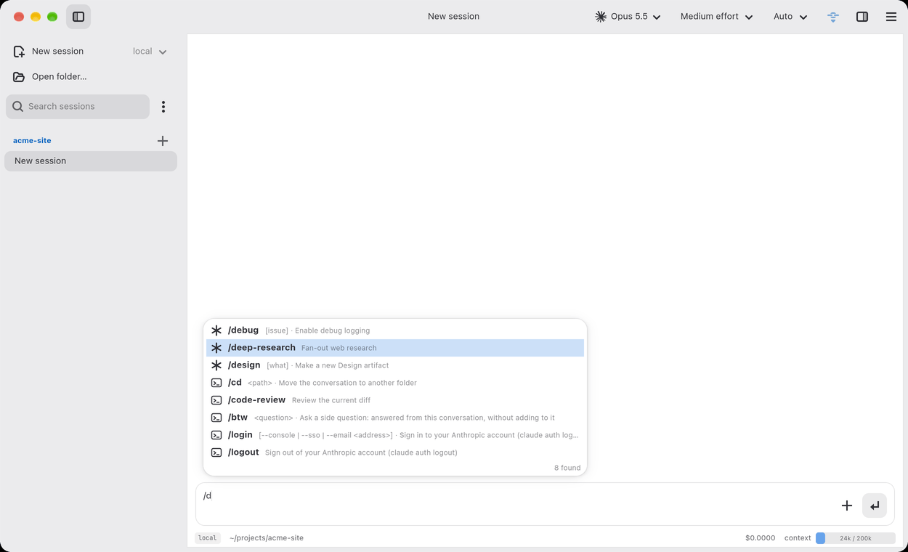<br>Slash commands |
| 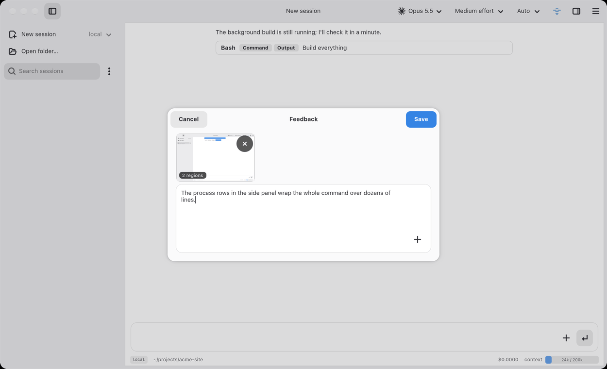<br>Send Feedback | 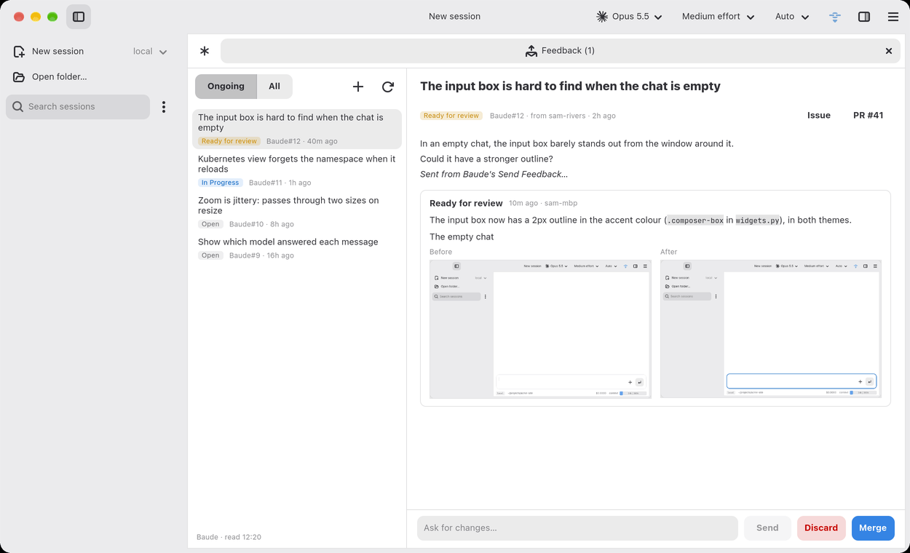<br>Ongoing Feedback |

## Meta

Meta (the spanner, first in the right bar of Baude and of Record) is a helper that operates the app: ask it to move
chats into a group, archive or rename them, list only some hosts or groups, or, in Record, move, add or delete pages
and propose edits to them. Every change it makes with the app's own tools shows under its reply with undo, and is
marked in the left bar (green added, red removed, blue moved) until you keep or undo it. Asked about a setting, it
changes it and puts the setting's own row in the chat for you to adjust. It runs on Haiku unless Settings → Meta says
another model: any model your claude lists, or any in the mesh that can call tools (Settings → Meta → Provider says
where it runs, and picks another host's copy), each given Meta's tools. On Claude's models it also runs shell
commands, edits files and looks things up on the web, in Claude Code's Auto mode, so it checks things for itself (a
file's path, what a host has, over ssh) rather than asking you; what Auto mode holds back it asks you about, Allow or
Deny, and commands and file edits have no undo. In Record it never edits the pages' own files. Settings → Meta → Run
commands turns that off; other models only read. It sets models up too: it says what runs them here, checks Ollama's
models and removes those that don't load (asking you first), adds an MLX model you've downloaded or an
OpenAI-compatible server, and builds `apple-claude` (asking first). It installs or downloads nothing you didn't ask
for. When a conversation is more than the model's context window holds (another model picked, or the conversation
grown), "Context Exhausted" shows over its box, the box off, and the context bar shows it full, the tokens used over
the window's, till a model with a bigger window is picked or the chat's cleared; Baude's chats do the same. Code mode
has it act by writing up to 10 lines of Python against the app's tools (`meta.py`). Ctrl+M (Control on macOS too),
from anywhere in the window, shows it and puts the focus in its box; pressed again while it's open, it closes it.

## Bots

A chat on a host made a Bot (right-click → Make Bot…) gets a name and a picture, and is listed at the top of the
sidebar. Its agent is given its name and its memory each time it starts; the Memory page shows the Bot's changes to
its memory, to accept or reject. Routines start it on a schedule, and it has a browser of its own (see Emission).

| | |
|---|---|
| 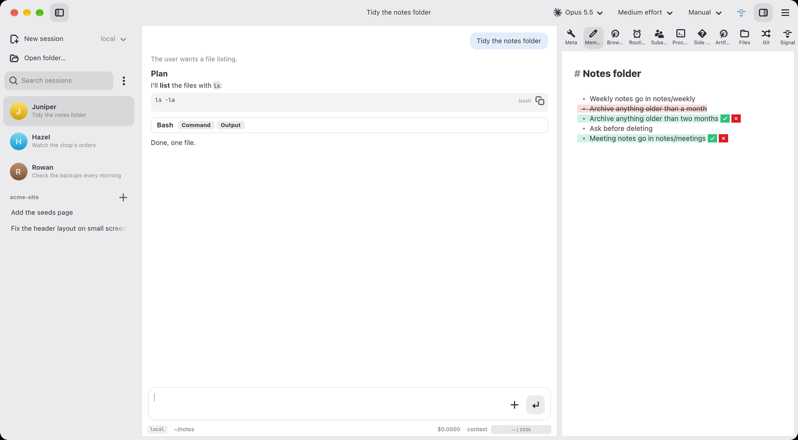<br>Bots, and a Bot's memory | 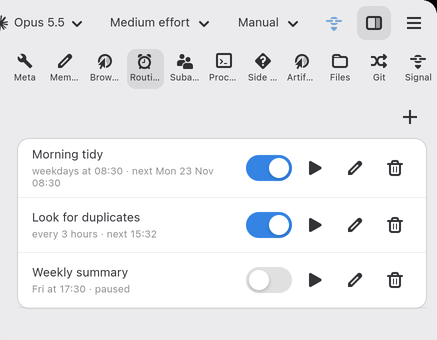<br>A Bot's routines |

## Codex backend (draft)

Install and sign into the Codex CLI on the machine hosting the session. Baude looks for
`codex` on the host process's PATH. Set `BAUDE_CODEX` to the executable path if needed,
then restart the Baude host process. The model picker lists the GPT-6, GPT-6.1,
and GPT-5.6 variants that Codex offers on that host, with each model's reasoning
effort options. Meta's Intelligence picker uses the local host's Codex catalog
and gives Codex access to Meta's app tools. You can also choose a model from the
headless entry point:

```bash
python3 baude_oneshot.py --model codex/gpt-6.1-sol --cwd . "Describe this repository"
```

Codex chats start in **Manual** (Codex's Ask for Approval). **Auto** routes
requests to Codex's automatic reviewer with the same workspace sandbox.
**Bypass Permissions** runs without the sandbox or approval prompts. Changes apply on the next turn. The
headless equivalents are `--mode default`, `--mode auto`, and `--mode bypassPermissions`.

The headless entry point also accepts `codex/<model-id>`. Codex App Server runs the
turns using the selected permission mode. Baude stores a display
history for chats started through Baude, and resumes the native Codex thread by ID.
Move to Trash moves Baude's transcript and leaves Codex's own copy in Codex.
Existing standalone Codex threads are outside the draft's scope. The draft supports
streaming text, command and file-change results, MCP tool results, basic approval
prompts, and interruption. Claude slash commands, conversation forks and rewinds,
and Codex-specific approval requests without a Baude UI are outside its scope.

## Local models

Besides Claude's, a chat can run a model one of this machine's inference providers serves: Apple's on-device model
(`apple-claude`, once it's built), MLX (`pi-claude`'s own server, on the models in `pi-claude/models.json`, or
added in `settings.json`'s `mlx_models`, that you've downloaded), [Ollama](https://ollama.com) (`settings.json`'s `ollama_url`, else `OLLAMA_HOST`, else 127.0.0.1:11434), or any OpenAI-compatible server
listed in `settings.json`:

```json
"endpoints": [{"id": "lmstudio", "name": "LM Studio", "url": "http://127.0.0.1:1234/v1", "key": "$LMSTUDIO_KEY"}]
```

All but Apple's run in [pi](https://pi.dev), which speaks their API, through `pi-claude` (pi installed in
`~/.local/share/baude/pi`). The model picker lists Claude's models, then every model of the chat's host and of the
other members of the mesh, each once however many hosts have it, each with its family's icon and under its
family's name (Claude, Qwen, Gemma…), with a search box on top: type to narrow, ↑ ↓ and Enter to pick. A model
picked runs on the first provider that has it:
the chat's host's, else the mesh's. The picker left of it says where the chat's model runs (local / MLX, studio /
Ollama), listing each provider that has it, by host: picking another moves the chat's model there. With one it's
greyed; on Claude's models it's gone, as Claude isn't a provider: `claude` runs Claude's models on the machine it's
on. The chat stays on its host either way: another member's Ollama or OpenAI-compatible server runs for it through
the mesh's proxy, so Meta can use it too, and its Apple or MLX model runs there as an agent whose tools are the
chat's host's. An Ollama model gets the context window Ollama loads it with (4k
unless its context length is raised), which is too small for pi's instructions and tools: the chat says so.

## Running it

You need Python 3.11+, GTK 4 and libadwaita 1.5+ with PyGObject (on Debian/Ubuntu:
`python3-gi gir1.2-gtk-4.0 gir1.2-adw-1`), and the `claude` CLI, signed in.

```bash
python3 baude.py             # in the current folder
python3 baude.py --install   # add Baude to your application menu
python3 record.py            # Record
```

Record, the second app, keeps notebooks of wiki pages in your own words, with Meta beside them, and reads a Claude
Code chat beside your notes.

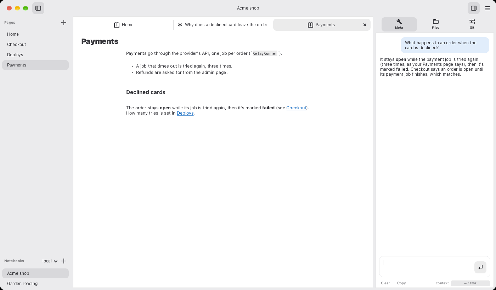

## Android

[android/](android/README.md) is Baude for your phone: the chats on your hosts and your Bots, over ssh or Tailscale.

## Emission

`emission.py` is Baude's browser, a window of its own for now: tabs, back and forward, an address bar that searches
too, and profiles (made, renamed and removed from the profile menu). Each profile keeps its own cookies and logins, so
a site signed in to once stays signed in there. A profile is open in one Emission at a time: start another on it,
and its page opens as a tab in the one already there. Downloads go to your
Downloads folder. Pages are WebKit's: Apple's WKWebView on macOS 14 or later, and WebKitGTK 6.0 on Linux
(`gir1.2-webkit-6.0` on Debian and Ubuntu, `webkitgtk-6.0` on Arch). On a Linux host with no display it starts a
virtual one of its own, with `xvfb-run` installed (package `xvfb`).

```bash
python3 emission.py [URL] [--profile NAME]
```

| | |
|---|---|
| 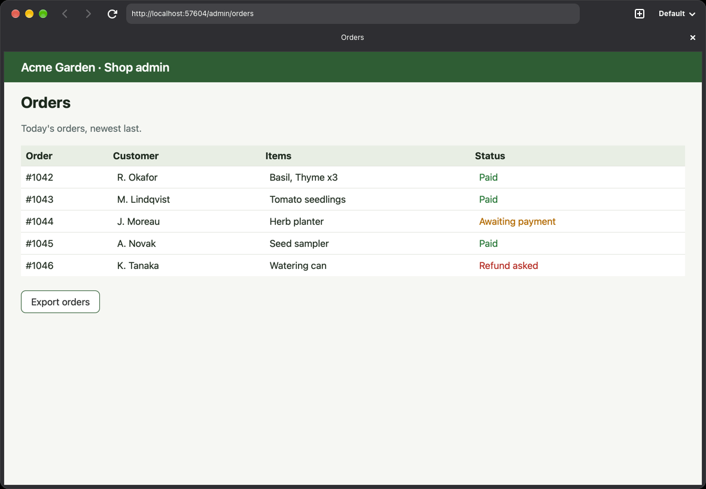<br>Emission | 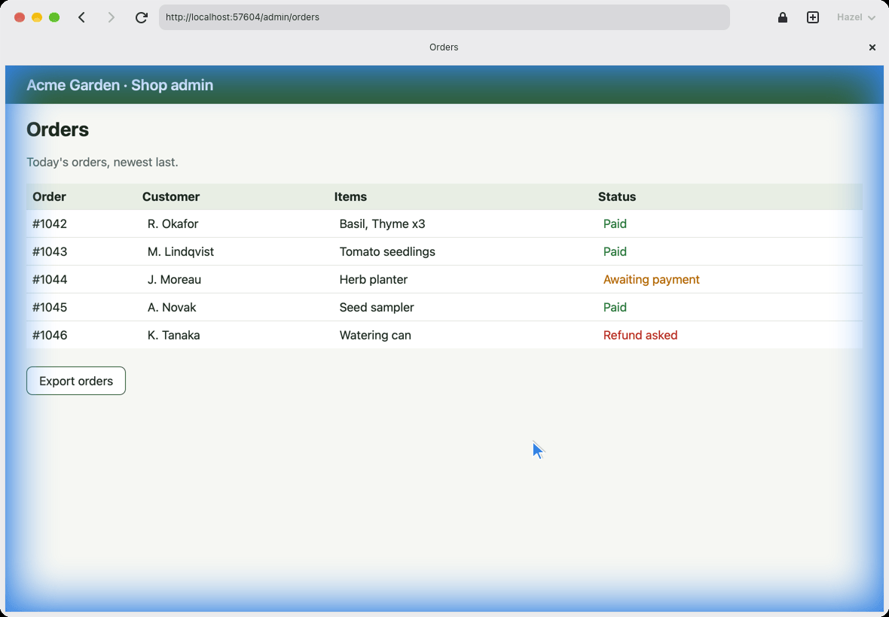<br>A Bot's browser in its own window, its pointer and glow |

A Bot has a browser of its own: its tools (`mcp__emission__…`) drive its own Emission profile, on any host of the
mesh. On each host its profile is its own there, made when it's first used and named after the Bot. The host process
starts Emission for it out of sight (no window on screen, no Dock icon; on Linux, a virtual display of its own), and
it goes after half an hour unused. Where a tool does what one of Claude in Chrome's does, it has that tool's name, and
its arguments' names where they mean the same (the tab tools without its _mcp; the mouse and keys as tools of their
own, not one computer tool): tabs_context, tabs_create, tabs_close, navigate, read_page and find (the page's elements,
with refs; read_page lists what's on screen and a screen above and below), get_page_text, screenshot (1024 px on its
long side at most) and zoom (a region of it at full detail), click, hover, drag, type, key, scroll (which says what
came into view), form_input, javascript_tool, read_console_messages, read_network_requests, resize_window,
browser_batch (several of them in one call), and prompts and answer_prompt for what a page asks (an alert, a confirm,
a site's sign-in, files to upload). Clicks and keys are real input: the pointer is moved to a place and pressed, and
keys go one at a time. A Bot only ever reaches its own profile, never yours or another Bot's.

To sign a Bot in to a site, open its profile from Emission's profile menu (its Emission steps aside) and sign in
there, or choose Copy Sign-ins to a Bot… in your own profile to copy your sign-ins for the sites you pick. Pages say
the browser is Safari (as its engine is); `EMISSION_USER_AGENT` sets another.

## Sessions on the network

`baude_headless.py` is a machine's host process for Claude Code sessions: one for each user, which owns that user's
sessions there and their claude processes, for Baude to start, watch and steer from that machine or another. It needs
only Python, not GTK, and runs any model Baude can that its machine has: Claude's with `claude`, Apple's with
`apple-claude` once built, and MLX's, Ollama's and an OpenAI-compatible server's with `pi-claude` (`baude_headless.py
models` lists them). It listens only on a Unix
socket in a folder of its user's own, with no port on the network. Baude on the same machine uses the socket, and reads
its sessions' transcripts where they are; Baude on another reaches it over ssh, as `ssh HOST baude_headless.py
connect`, which carries the protocol between ssh and the socket and starts the host process if it isn't running. So
ssh decides who may: Baude never asks for a password (`BatchMode`), and uses your keys or agent as `~/.ssh/config` has
them, with the host already in `known_hosts`. Put `baude_headless.py` on each host's `PATH`, or give Baude its path
there (right-click the host → Host Command…).

Adding a host also links this machine's host process to that host's, and the link works both ways: that host, and every
host it's linked to, can then start, watch and steer chats here and run this machine's models, as this machine can on
them. The hosts linked like this form one mesh. A host reached only through another (build-box, linked to lab-mac, which
is linked here) is listed under Hosts as "through lab-mac", and everything said to it goes through lab-mac. Each host
tells the mesh its model providers. One that serves an OpenAI-compatible API, such as Ollama, can be run from any member
through a proxy on 127.0.0.1 that the member's own host process runs; Apple's model and pi's run where they are, in a
chat started on that host. From the command line, `baude_headless.py link DEST`, `unlink DEST` and `mesh` do the same,
and `--member ID` reaches a member of the mesh in place of `--host`. Right-click a host → Deactivate, and it's left out:
it isn't reached from here, nor let reach here, and it's grayed with its chats, till you Activate it (or
`baude_headless.py deactivate DEST`, `activate DEST`).

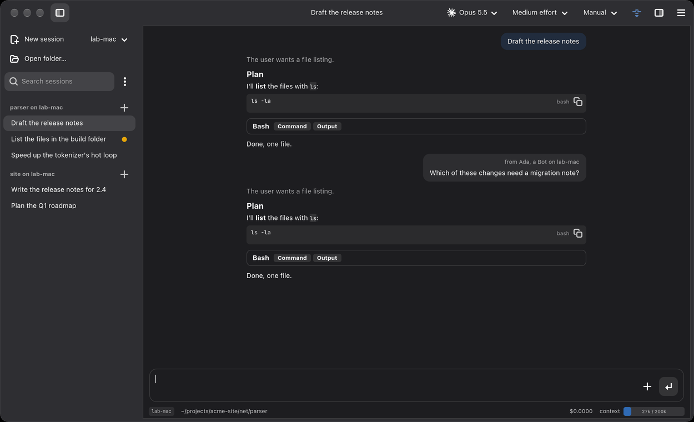

Heads start the host process when they need it, so there's nothing to run by hand. With no head attached and no link to
another host it does nothing: no timers, a session's claude stopped once it's been idle half an hour, and the process
itself gone after four hours with nothing running and no link to another host (`--idle-minutes`, `--exit-after-hours`).
On macOS, at the screen, it's an item in the menu bar, with no Dock icon: how many sessions it has and which are
running, and Quit. Quitting it (or `baude_headless.py quit`, or SIGTERM) stops its claudes, keeping their transcripts,
so their sessions are resumed next time.

`baude_oneshot.py` starts one session in a host process, attaches, and streams what its claude says to stdout as JSON
lines, as `claude -p --output-format stream-json` does. The session goes on in the host process, so Baude lists it,
under its host and group, and can be opened there.

```bash
python3 baude_oneshot.py --cwd ~/src/app --model opus --effort high "Run the benchmarks"
python3 baude_oneshot.py --host lab@lab-mac.local --group Lab "Bisect the flaky login test"
python3 baude_oneshot.py --resume SESSION "Now fix it"   # its id: the first line's session.id
python3 baude_headless.py list --host lab@lab-mac.local
python3 baude_headless.py archive SESSION   # or unarchive, or delete (its transcript to the trash)
```

Its first line is `{"type": "baude", "event": "started", "session": {...}}`, with the session's `id`; then claude's
lines, till its turn's `result`. With `--input`, each line on stdin is a stream-json message for claude, a user message
or a `control_response` answering a permission it asks for, and `--follow` keeps it going till stdin closes; without
`--input`, what it asks is denied, or, with `--ask-timeout`, left to the host process to answer then. It takes
claude's per-session options too: `--system`, `--add-dir`, `--allow`, `--deny`, `--fork-from`. It exits 0, 1 if the
turn ended in an error or claude ended before it did, 2 if the host or the session couldn't be had, and 3 if the host
process went mid-turn.

Moving to them, from `baude_server.py`:

- `baude_server.py serve` is `baude_headless.py` (or nothing: a head starts it). It no longer takes `--port` or
  `--bind`, and wants no token.
- `baude_server.py start --prompt TEXT …` is `baude_oneshot.py … TEXT`, with the same options (`--ask-timeout` and
  `--ask-default` for a new session only). It waits for the turn and prints it, rather than printing the session's id
  and leaving: `baude_oneshot.py … TEXT | head -1` gives the id, and the turn's still seen to its end.
- `baude_server.py servers` has no successor, as nothing's looked for on the network; `list`, `models` and `stop` are
  `baude_headless.py`'s, with
  `--host DEST` (an ssh destination) instead of `--server HOST:PORT`.
- A client of `baudelib/wire.py` connects with `wire.connect_local()` on the same machine, or `wire.connect_ssh(DEST)`
  from another, instead of `wire.connect(host, port)`: the protocol's the same. `baudelib.hosts.reach(DEST)` starts
  this machine's host process first if it isn't running. Or it runs `baude_oneshot.py` and reads its stdout.
- A client that isn't Python asks `baude_headless.py socket` where the socket is, rather than copying its rules
  (`$BAUDE_RUNTIME_DIR`, `$XDG_RUNTIME_DIR`, `$XDG_STATE_HOME` or `~/.local/state`, or `/tmp/baude-<uid>` for a path
  too long for a socket; `XDG_RUNTIME_DIR`, which comes first, can differ between a session at the screen and one over
  ssh: ask from where the client runs), or talks to `baude_headless.py connect`'s stdin and stdout.
- A client that attaches to a session but won't answer what it asks says so (`answers: false` on `attach` or
  `start`): the host's `ask_timeout` then runs out and `ask_default` answers, as if nobody were attached.
- `archive`, `unarchive` and `delete` clean up a client's sessions: archived ones are listed only to a subscriber
  that asks for them (`subscribe {archived: true}`); a deleted one's transcript goes to the trash once its claude has
  ended, as Baude's Move to Trash does with its own, and heads attached to it hear `deleted`.
- On another machine, put `baude_headless.py` on `PATH` where `baude_server.py` was, for ssh to find.

The sidebar lists one host's sessions: the host picked beside New session, where a new session is made (`local`: this
machine's own chats, Claude Code's and Claude Desktop's, and its host process's), kept across restarts. A host that's
gone or deactivated stays picked, its chats as they were last seen, and says so over them. Right-click the host (or
press and hold it) for Add Host…, and for another machine's, Host Command… (one reached over ssh) and Deactivate or
Activate. ⋮ beside its search → Groups picks which groups are listed: a click lists only that one, and Shift or Ctrl
(⌘) and a click adds or takes away one, as the Git page's branch list does. A group is the label a session was started with.

Baude doesn't look for hosts on the network. This machine's host process it finds by its socket. Another machine's
you give it by where ssh goes: right-click New session's host → Add Host… (or `BAUDE_HOSTS=dest,…`) takes an ssh
alias, a host or `user@host` (`user@name.local` on the local network, a Tailscale name on a tailnet), and it's kept
from then on.

Each host shares one ssh connection among Baude's sessions there (`ControlMaster`), so sshd's `MaxSessions` (10 by
default) is how many can be open at once. A host process started over ssh, by `connect`, has that ssh session's
environment (its `PATH`, and on macOS no keychain, so `claude` there may need signing in another way); one started at
the screen, by Baude there, has the screen's. A home folder shared between machines (NFS) shares their host processes'
state, which isn't supported.

## License

[MIT](LICENSE). The Kubernetes sidebar icons in `widgets.py` are Freelens' (MIT) and Material Icons (Apache-2.0).
[Pygments](https://pygments.org), which colours code, is in `vendor/` under its own BSD-2-Clause licence (see
[vendor/README.md](vendor/README.md)).
