# Baude

Baude is a GTK4 / libadwaita desktop app for [Claude Code](https://claude.com/claude-code). It runs the `claude` CLI
and shows the chat, its tool calls and every session on the machine.

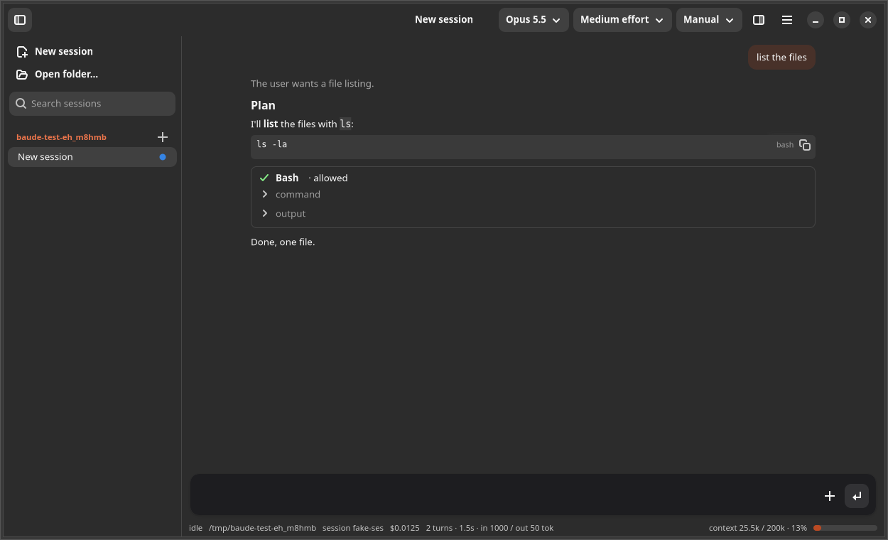

## Chat

| | |
|---|---|
| 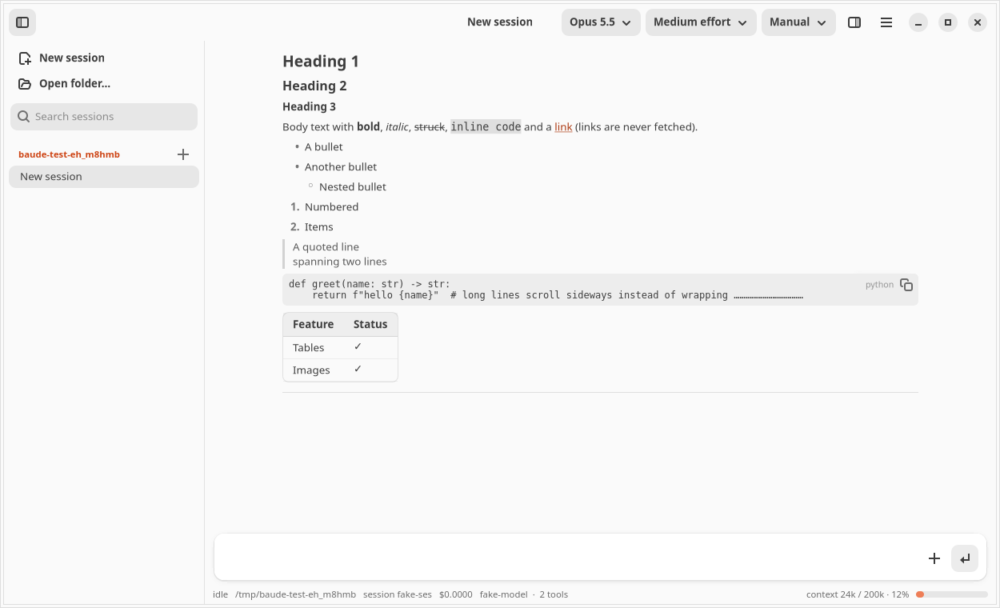<br>Markdown | 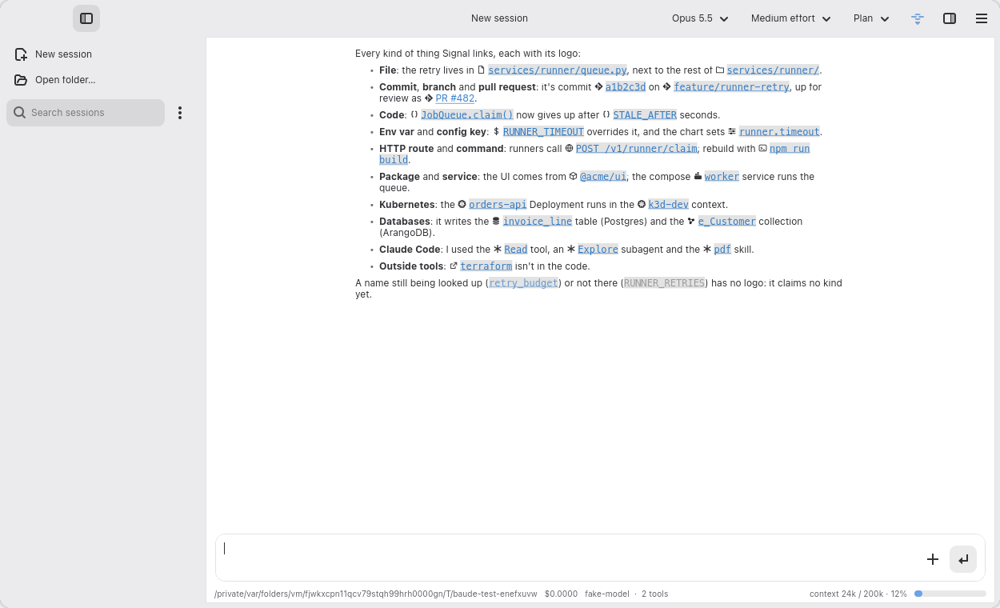<br>Signal links |

## Tools and permissions

| | |
|---|---|
| 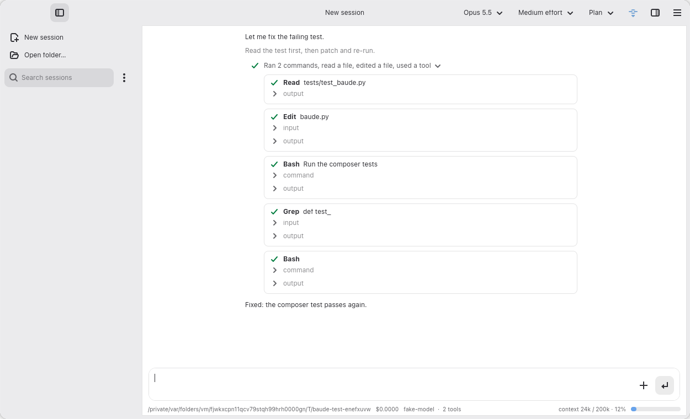<br>Tool calls | 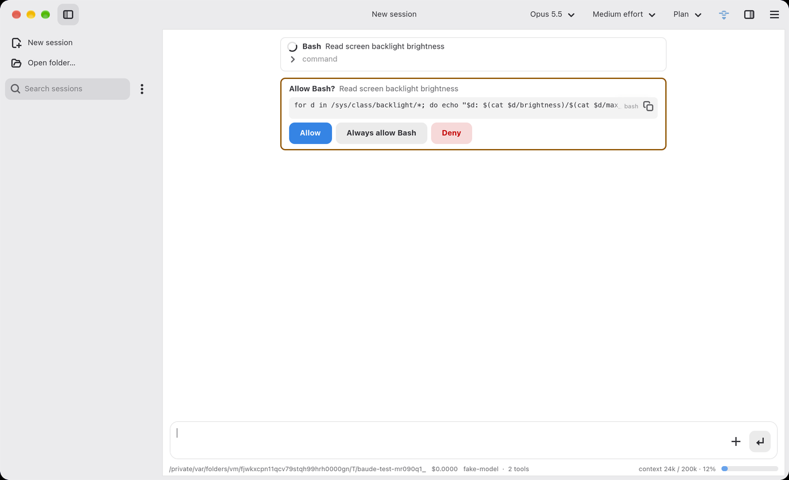<br>Command approval |
| 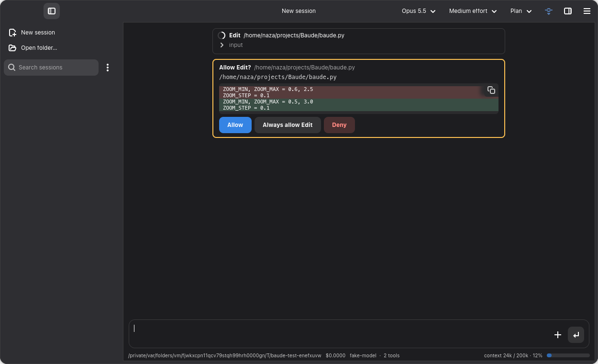<br>Edit approval | 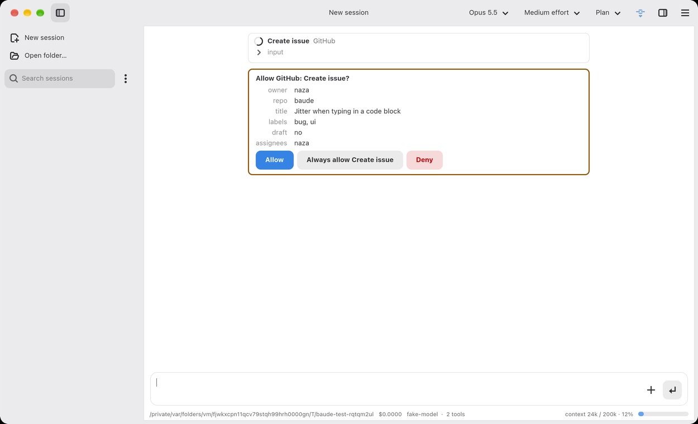<br>MCP tool approval |

## Git and Kubernetes

| | |
|---|---|
| 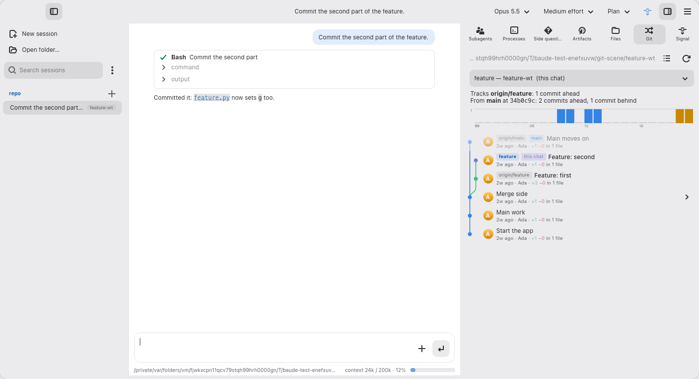<br>Git history | 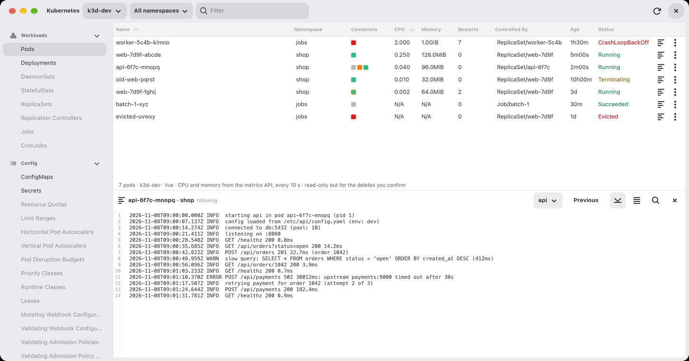<br>Kubernetes pods and logs |

## Input and feedback

| | |
|---|---|
| 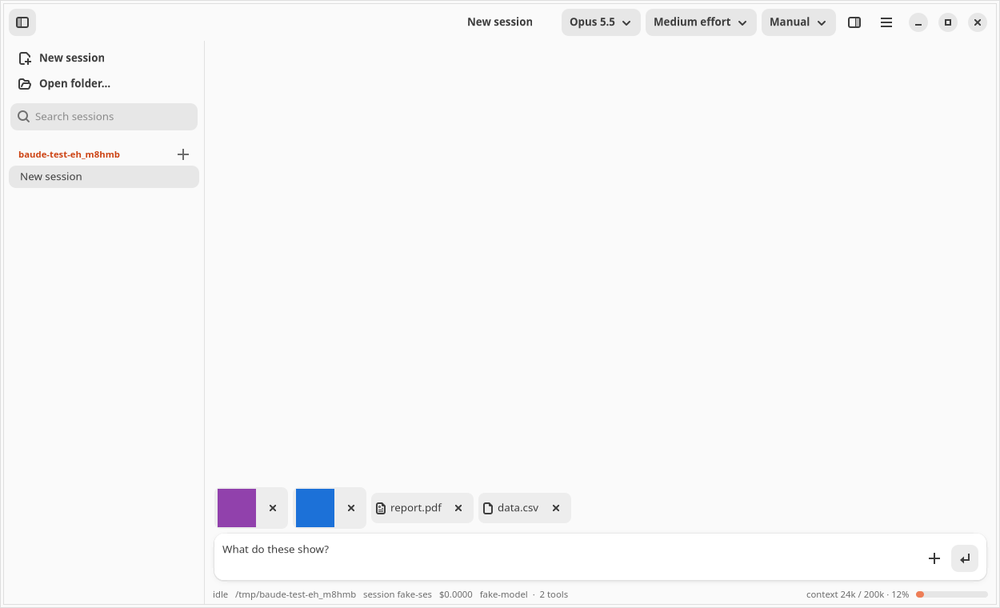<br>Attachments | 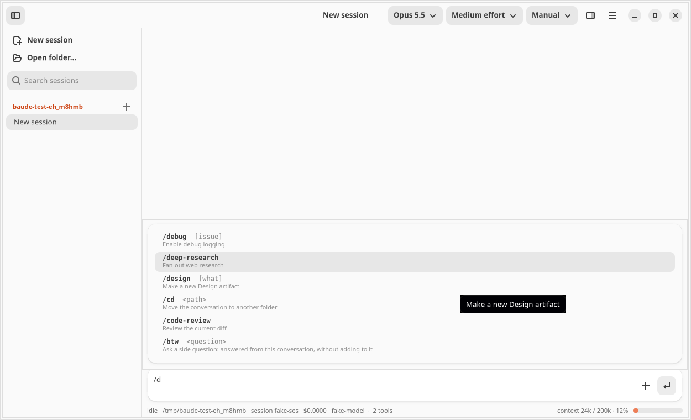<br>Slash commands |
| 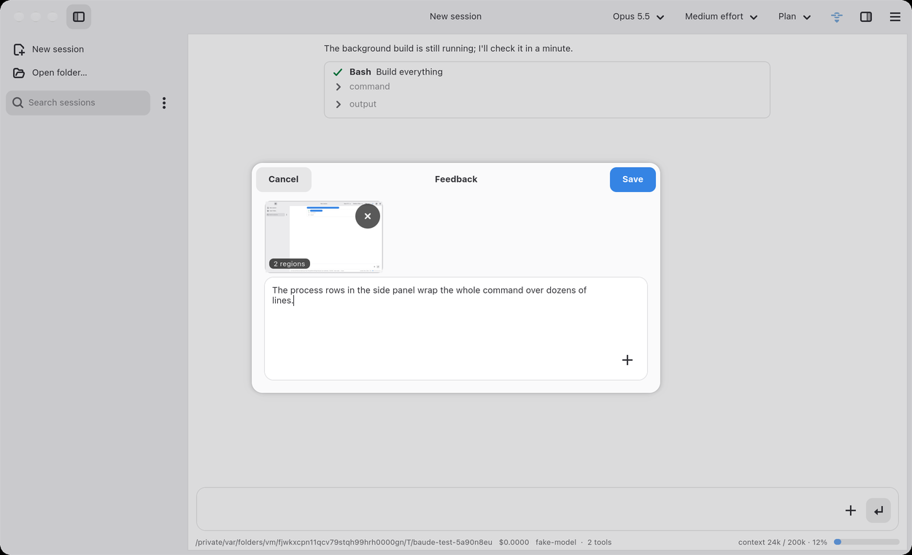<br>Send Feedback | 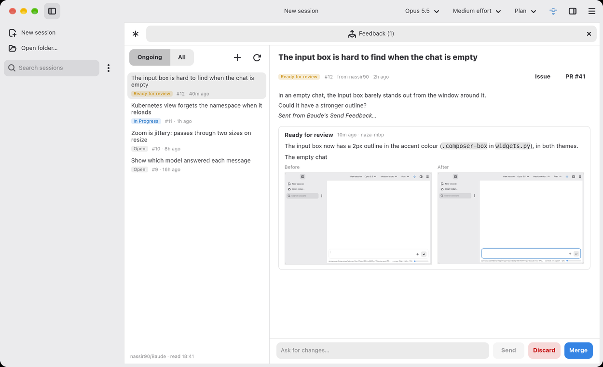<br>Ongoing Feedback |

## Running it

You need Python 3.11+, GTK 4 and libadwaita 1.5+ with PyGObject (on Debian/Ubuntu:
`python3-gi gir1.2-gtk-4.0 gir1.2-adw-1`), and the `claude` CLI, signed in.

```bash
python3 baude.py             # in the current folder
python3 baude.py --install   # add Baude to your application menu
python3 record.py            # Record
```

## Sessions on the network

`baude_server.py` runs Claude Code sessions headless on a machine, for Baude to start, watch and steer from another
(or the same) one. It needs only Python, not GTK, and runs any model Baude can that its machine has: Claude's with
`claude`, Apple's with `apple-claude` once built, and pi's with `pi-claude` (`baude_server.py models` lists them).
Baude finds servers on the local network by multicast DNS (`_baude._tcp`); ⋮ beside the sidebar's search → Group
picks Local (this machine's sessions) or a group on the network.

```bash
python3 baude_server.py --group Lab      # serve, in the group Lab
python3 baude_server.py start --prompt "Run the benchmarks" --cwd ~/src/app --model opus --effort high
python3 baude_server.py list
```

⋮ → Group → Add server… (or `BAUDE_SERVERS=host:port`) gives Baude a server it can't find by itself;
`BAUDE_NETWORK=0` stops it looking. A server bound to this machine only (`--bind 127.0.0.1`) isn't said on the network,
and wants the token in its file in `~/.local/share/baude/local-servers`, which only its owner can read: Baude, and
`baude_server.py`'s own commands, on the same machine find it, and its token, there. There's no sign-in yet for one on
the network: anyone who can reach its port can start sessions on it and read files in its sessions' folders.

## License

[MIT](LICENSE). The Kubernetes sidebar icons in `widgets.py` are Freelens' (MIT) and Material Icons (Apache-2.0).
