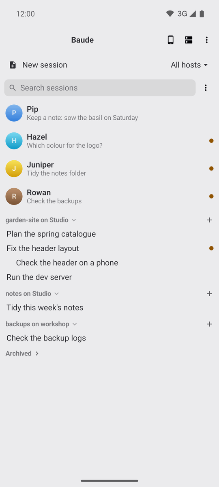
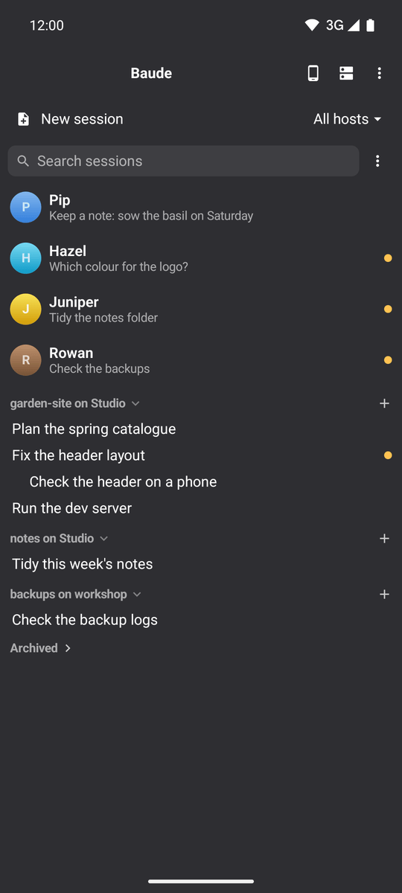
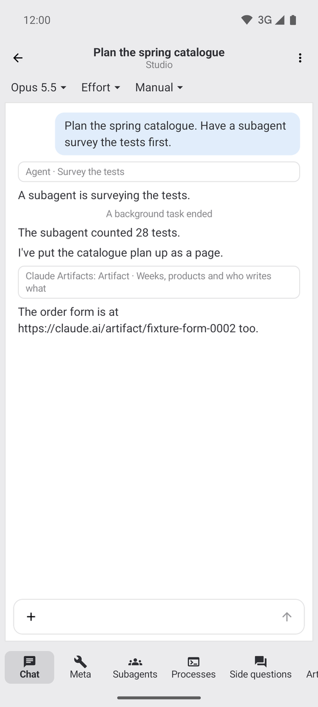
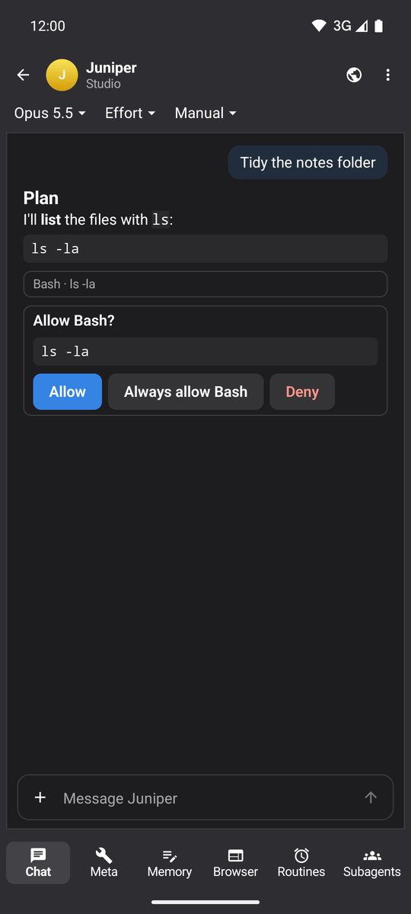
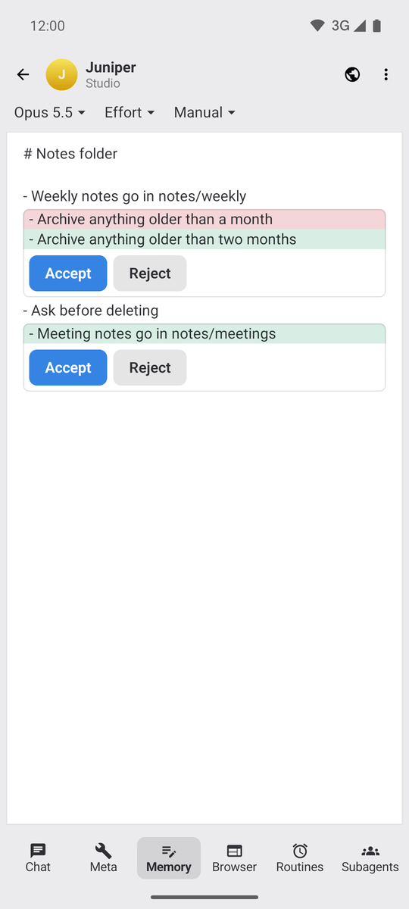
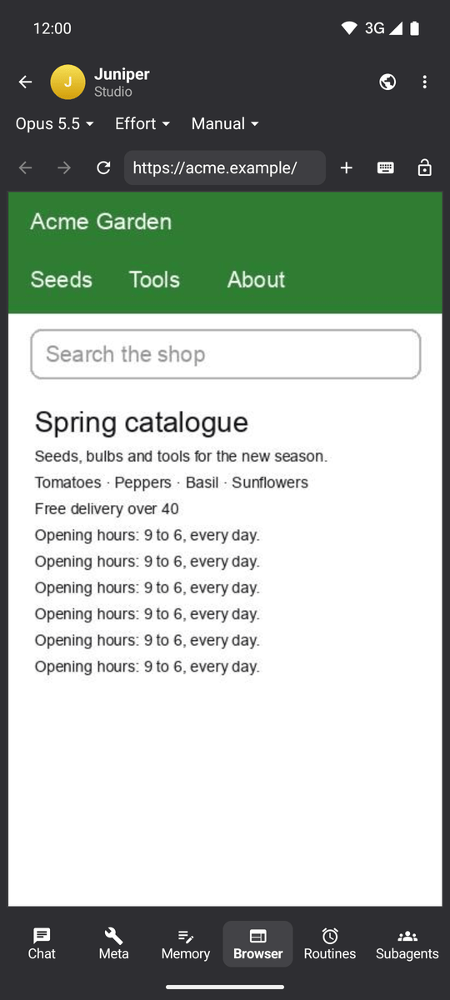
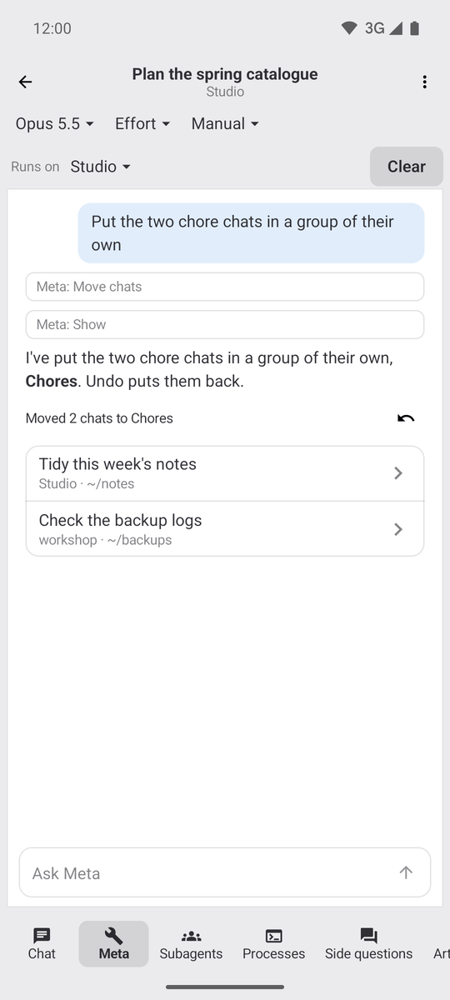
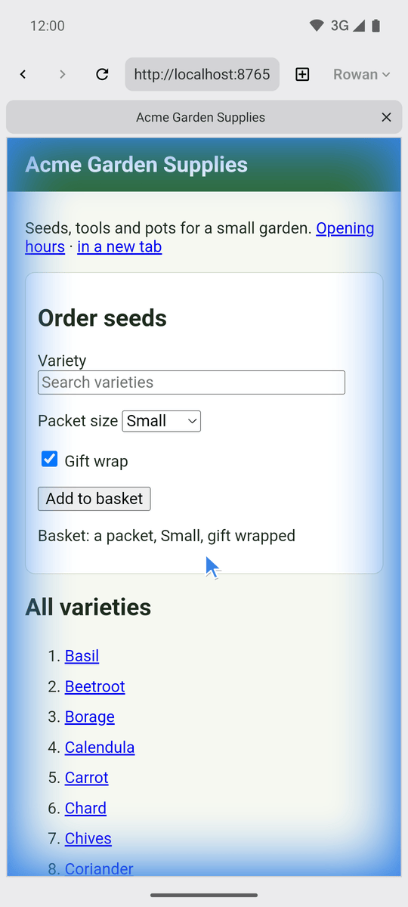
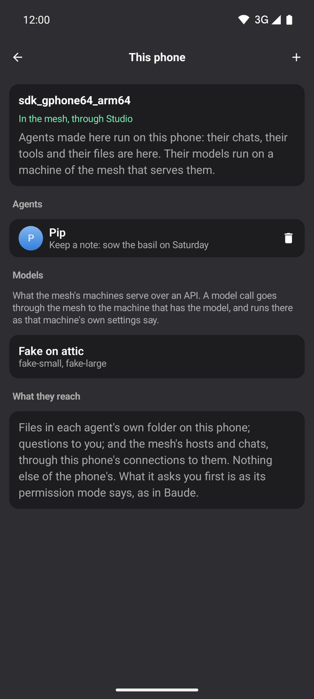

# Baude for Android

Baude on your phone: the chats on your hosts, your Bots as contacts, and Meta, the helper that operates the app. The
phone runs no `claude` of its own. It reaches each host's host process (`baude_headless.py`) over ssh, as Baude on
another machine does: add a host as `user@host`, its Tailscale name on a tailnet, and the phone runs
`baude_headless.py connect` there. Its ssh key is made in the Android Keystore, which signs with it and never gives it
out; put its public half (Hosts shows it) in the host's `~/.ssh/authorized_keys`. A host's own key is trusted once
you've compared it. Through the hosts you add, the phone reaches every member of their mesh, and joins it: agents
made on the phone ("This phone") run there, their models served by a machine of the mesh.

| | |
|---|---|
| <br>Home: Bots, then chats by folder and host | <br>The same, dark |
| <br>A chat: a subagent and an artifact | <br>A command asking to run |
| <br>Memory: a Bot's changes, to accept or reject | <br>Browser: a Bot's browser on its host |
| <br>Meta: chats moved to a group, with undo | <br>Phone Use: a Bot driving the phone's browser |
| <br>This phone: its agents, and the mesh's models | |

The pages along the bottom are Baude's side panel: Chat, Meta, Memory, Browser and Routines (a Bot's), then Subagents,
Processes, Side questions, Artifacts, Files, Git and Signal.

## Building it

You need JDK 17 and the Android SDK (Android Studio has both; or set `sdk.dir` in `local.properties`, or
`ANDROID_HOME`). Build from a checkout of the whole repository: the phone's browser takes its page scripts from
`../emission.py`.

```bash
cd android
./gradlew assembleDebug
adb install app/build/outputs/apk/debug/app-debug.apk
```

It runs on Android 8 (API 26) or later.
